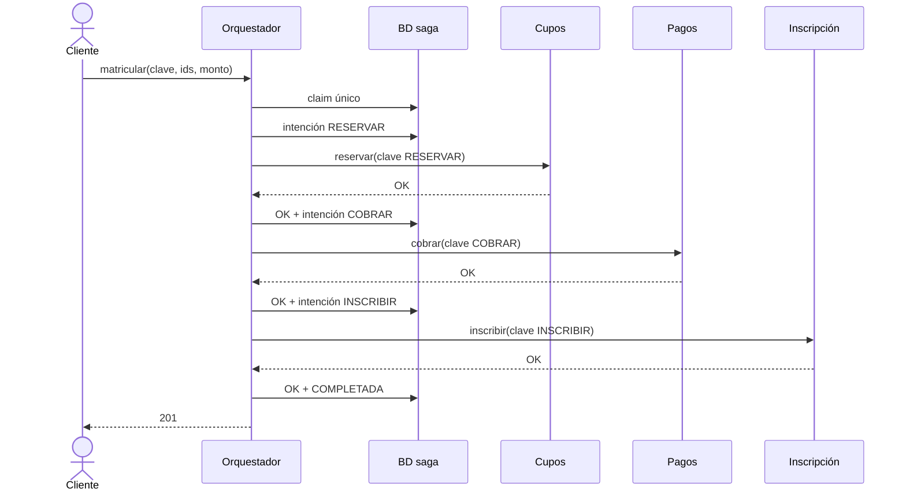
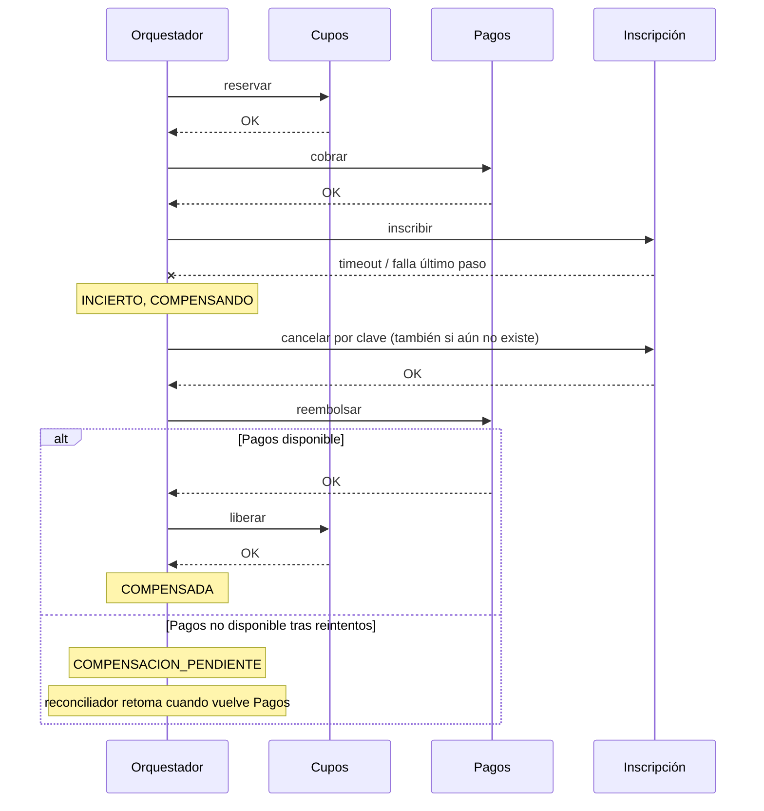
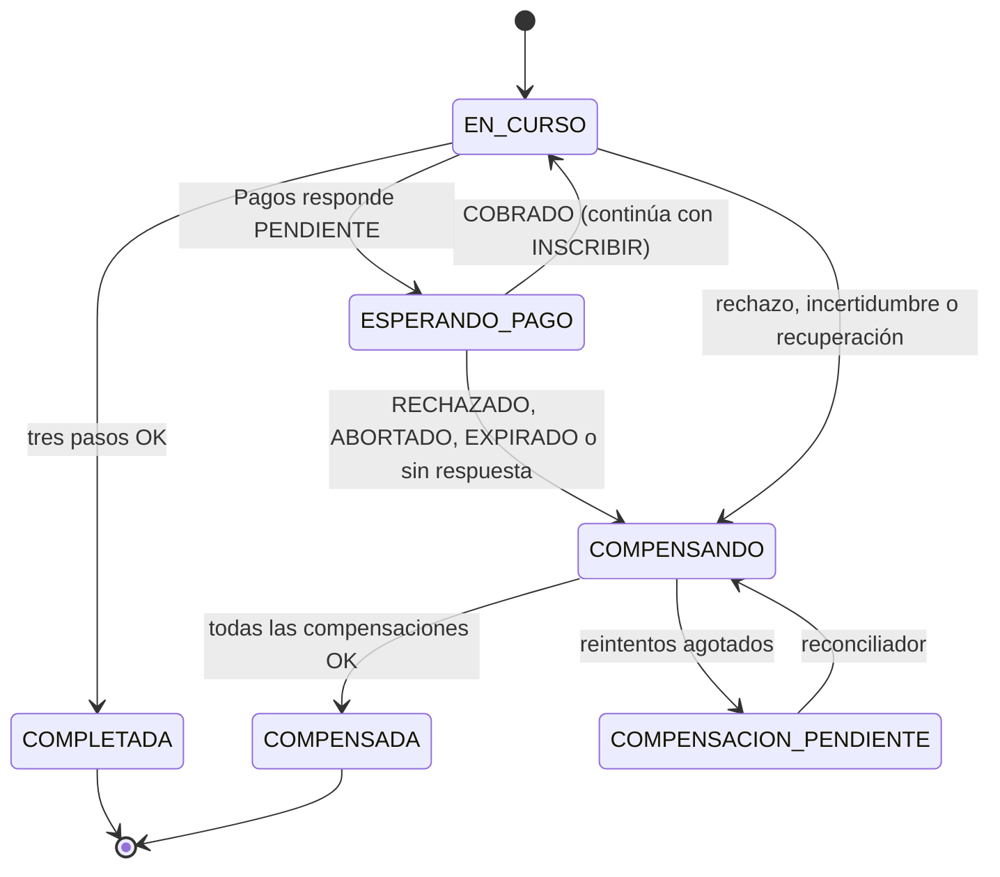

# Saga de matrícula — diseño y operación

## 1. Responsabilidades y contrato

El orquestador ejecuta RESERVAR → COBRAR → INSCRIBIR. Cupos conserva el invariante de capacidad; Pagos (carpeta `pagos/`) cobra con Transbank Webpay Plus y es dueño del estado del cobro; Inscripción conserva alumnos y registra solamente la inscripción local. `CONFIRMADA` significa inscripción ACTIVA y `ANULADA` significa baja. Se mantienen estos nombres para los consumidores existentes.

`POST /v1/matriculas`, con `X-API-Key: ORCHESTRATOR_API_KEY` e `Idempotency-Key`, recibe `{alumno_id, curso_id, monto}`. Monto es un entero positivo en unidades monetarias; la moneda es el peso chileno (CLP). Devuelve la saga: 201 si completa, 200 si se repite una completada, 202 si sigue en proceso, espera el pago del comprador (`ESPERANDO_PAGO`, con `pago_url`) o requiere conciliación, 503 si terminó compensada, 409 si otro intento ocupa el par alumno/curso y 422 si se reutiliza una clave con otro payload. Un rechazo definitivo queda registrado en `motivo_fallo`; el 503 expresa que la matrícula completa no se realizó. El cliente consulta `GET /v1/sagas/{id}`. Un replay devuelve el estado actual sin repetir efectos.

Inscripción acepta `Idempotency-Key` en `POST /v1/enrollments`; conserva el índice único por estudiante y clave de U1 para evitar revelar claves de otros estudiantes. Un reintento devuelve la fila existente, incluso ANULADA, sin reactivarla. Para reinscribirse se usa otra clave. La segunda baja y las bajas simultáneas responden 200. El índice parcial de inscripciones activas se conserva. Inscripción ya no llama a ocupar/liberar ni usa el circuit breaker para esas operaciones. Las consultas `/v1/courses` conservan su cliente y circuito de lectura de Cupos.

**Migración coordinada desde U1:** cambian deliberadamente las semánticas de alta/baja. Se conservan las rutas v1 para esta entrega; no se debe desplegar a consumidores U1 sin coordinarlos. El verificador conserva la base histórica y admite solamente la eliminación de los errores de Cupos en alta/baja y del 409 por segunda baja. No se reescribe la línea base para ocultar otras rupturas. Los experimentos de U1 son históricos y no representan el nuevo flujo.

**Datos existentes:** no se borran volúmenes. Las inscripciones CONFIRMADAS que ya tenían reserva en U1 siguen siendo históricas; darlas de baja ahora no libera automáticamente esa reserva. Antes de migrar, detener escrituras U1, conciliar y cerrar sus PENDIENTES y resolver las reservas de las matrículas que se darán de baja. Este cambio no adopta automáticamente operaciones antiguas dentro de sagas nuevas.

## 2. Persistencia, concurrencia y recuperación

`sagas` contiene id, idempotency_key UNIQUE, request_hash, alumno_id, curso_id, monto, estado, motivo_fallo, pago_url, pago_expira_at, created_at y updated_at (el cambio de esquema exige borrar el volumen `sagas_data` si venía de una versión anterior; el orquestador lo detecta y se niega a arrancar con un mensaje claro). Un índice único parcial sobre alumno/curso incluye EN_CURSO, ESPERANDO_PAGO, COMPENSANDO, COMPENSACION_PENDIENTE y COMPLETADA. La inserción decide atómicamente la concurrencia; no se implementa un “consultar y después insertar”. Una COMPLETADA conserva el par ocupado. No se agrega un flujo de baja global de saga: la baja local no reembolsa ni libera recursos.

`saga_steps` contiene saga_id, paso, tipo (forward/compensacion), estado (PENDIENTE/OK/FALLIDO/INCIERTO), intentos, clave, error y timestamps, con unicidad por saga/paso/tipo. Cada intención se confirma antes de llamar. Claves forward: `{saga_id}:{paso}`; compensación: `{saga_id}:comp:{paso}`. En Cupos y cancelación de Inscripción se envía la clave original para identificar el recurso que se cancela; el registro de compensación mantiene su clave propia. Pagos recibe ambas claves.

Un paso incierto se compensa también. Un PENDIENTE encontrado tras una caída puede haber ejecutado el efecto y se trata como incierto. Las compensaciones se recorren en orden inverso, con reintentos y backoff exponencial acotados. Si una falla, se conserva COMPENSACION_PENDIENTE; no se liberan pasos anteriores hasta resolverla. Al arrancar y periódicamente se revisan sagas antiguas no terminales y se compensan. Los pasos de compensación OK no se repiten.

Se toma un candado por saga durante la ejecución y conciliación, independiente de los commits: advisory lock con conexión dedicada en PostgreSQL, o flock junto a la base SQLite. La base y sus archivos de candados deben vivir en el mismo volumen persistente para todos los workers SQLite. Una muerte del proceso libera el candado. No se debe borrar `.saga-locks` con procesos activos. SQLite no se comparte entre máquinas; para varias máquinas se debe configurar `SAGA_DATABASE_URL` con PostgreSQL y un pool acorde a la concurrencia.

Cupos registra una liberación anticipada sin incrementar capacidad. La misma clave no podrá ocupar después, aunque la reserva original llegue tarde. Una clave de otro curso sigue siendo inválida. Se desactiva la purga por defecto: borrar tombstones permite reejecutar solicitudes antiguas. Una retención finita exige una ventana de reintentos acordada entre todos los servicios. Inscripción tiene una cancelación interna por clave que también crea una fila ANULADA anticipada.

## 3. Resiliencia y operación

Cada dependencia tiene una instancia del circuit breaker de U1 y un semáforo independiente. Timeouts, errores de transporte, respuestas inválidas y 5xx cuentan como falla; rechazo de negocio e idempotencia 422 no abren el circuito. Si el circuito de Pagos está OPEN antes de comenzar, no se reserva. Un cambio de disponibilidad posterior puede requerir compensación. El bulkhead rechaza sin esperar, sin consumir cupos de concurrencia de otra dependencia.

`PUT /internal/fault` acepta `{falla: bool, lentitud_seconds: 0..30}`, exige `X-Internal-Key` y afecta solo al alta de Inscripción; la baja interna permanece disponible. El control se restablece al reiniciar el proceso y debe usarse con un worker para experimentos reproducibles. El gateway rechaza `/internal`; los servicios no publican puertos REST directamente. Administrar el interruptor desde la red interna, por ejemplo con `docker compose exec` y un cliente HTTP. No registrar los secretos en comandos compartidos.

Cada transición produce un mensaje JSON con saga_id, paso, estado y duracion_ms, sin cuerpos, RUT ni email. `docker compose logs orquestador` permite ver el orden inverso. `/metrics` expone sagas por estado, compensaciones OK persistidas, duración agregada por paso/dependencia (sum/count), estado de circuitos y rechazos del bulkhead. Circuitos, contadores de llamadas y controles de falla son locales al proceso y se reinician con él.

**Contrato de Pagos (implementado en `pagos/`; ver [`pagos/README.md`](../pagos/README.md)):**

| Operación | Petición | Respuesta |
|---|---|---|
| POST /v1/payments | alumno_id, curso_id, monto (CLP); `Idempotency-Key` forward; `X-API-Key` = PAGOS_API_KEY | 201/200 `PENDIENTE` + `redirect_url` + `expira_at` (el comprador debe pagar en Webpay); `RECHAZADO`; 409 `PAGO_CANCELADO` (cancelación anticipada); 422 clave con otro payload; 503/502 Transbank no disponible |
| POST /v1/payments/refund | original_key; `Idempotency-Key` de compensación | `REEMBOLSADO` (reembolso real en Transbank), `CANCELADO` (el cobro seguía abierto y se canceló), `INEXISTENTE` (no hubo cobro; deja una cancelación anticipada); 503 si hay una confirmación en curso |
| GET /v1/payments/by-key/{clave} | `X-API-Key` | `PENDIENTE`, `PROCESANDO`, `COBRADO`, `RECHAZADO`, `ABORTADO`, `EXPIRADO`, `CANCELADO`, `REEMBOLSADO` o `INEXISTENTE` |
| GET /v1/pagos/ir/{payment_id} | pública vía gateway | formulario que envía `token_ws` a Webpay |
| GET/POST /v1/pagos/retorno | pública vía gateway; `token_ws` o `TBK_TOKEN` | confirma (commit) con Transbank y muestra el resultado; avisa al orquestador |

Pagos hace el reembolso repetible y guarda una cancelación anticipada cuando no existe el cobro: un cobro tardío con esa clave no se ejecuta. Las transiciones son atómicas (`UPDATE … WHERE estado IN …`), de modo que un retorno de Webpay y una compensación simultáneos no pueden contradecirse. El cliente no considera un 404 de reembolso como éxito. Solo viajan ids, monto y claves: el orquestador nunca recibe el token de Webpay y Pagos no almacena datos de tarjeta. El orquestador usa una credencial propia de Pagos (`PAGOS_API_KEY`); ya no le envía la clave administrativa de Inscripción.

**Cobro con redirección (Webpay Plus).** Webpay no es un cargo servidor a servidor: el comprador paga en un formulario de Transbank. Por eso `COBRAR` puede devolver `PENDIENTE`; la saga guarda `pago_url`, el paso queda PENDIENTE (hay un cobro abierto que, si hace falta, se cancela) y la saga pasa a `ESPERANDO_PAGO` sin ocupar un hilo. Se reanuda cuando Pagos tiene el resultado, por dos caminos independientes: (a) un **aviso** de Pagos a `/internal/pagos/resultado`, que es solo una pista (el orquestador consulta a Pagos y actúa según su respuesta, nunca según el mensaje) y (b) un **sondeo** del reconciliador cada `SAGA_PAGO_POLL_SECONDS`, de modo que un aviso perdido no bloquea la saga. `COBRADO` continúa con INSCRIBIR. `RECHAZADO`, `ABORTADO` y `EXPIRADO` terminan el cobro como FALLIDO (Pagos garantiza que no habrá cobro) y solo se libera el cupo. Si Pagos no informa nada hasta `pago_expira_at` + gracia, el paso se trata como INCIERTO y la compensación pide a Pagos cancelarlo o reembolsarlo. Las sagas ESPERANDO_PAGO no se compensan por inactividad: pueden estar pagando.


## 4. ADR breves

**ADR-6: orquestación sobre coreografía.** Decisión: orquestación persistente. Tres pasos lineales, una máquina de estados y compensación demostrable favorecen un coordinador central. Costo: acoplamiento con los tres contratos y un punto único de falla. Mitigación: estado durable, intención previa a cada llamada, exclusión por saga y recuperación periódica; el coordinador puede reiniciarse sin repetir efectos.

**ADR-7: saga sobre 2PC.** La pasarela externa no participa en 2PC. Mantener bloqueos mientras el coordinador o la pasarela fallan perjudica disponibilidad. Se acepta falta de aislamiento: durante la saga hay un cupo reservado sin pago confirmado. El reembolso es compensación semántica, no rollback; puede tardar y quedar pendiente. Backoff y límites de reintentos acotan carga y costo hacia la pasarela.

**ADR-8: pago por redirección con espera dentro de la saga.** Transbank Webpay Plus exige que el comprador pague en su formulario, así que el cobro no puede resolverse en una llamada síncrona. Decisión: `COBRAR` crea la transacción y la saga queda ESPERANDO_PAGO (estado persistido, sin hilos bloqueados); Pagos es la fuente de verdad del cobro y el orquestador la consulta, con un aviso solo como optimización. Alternativas descartadas: (1) bloquear la petición hasta que el comprador pague, que agota hilos y supera cualquier timeout; (2) OneClick, que permitiría cobrar sin redirección pero exige una inscripción previa de la tarjeta; (3) confiar en el aviso, que ante una pérdida dejaría cupos retenidos. Costo: un estado más y la falta de aislamiento dura el plazo de pago (por defecto 10 minutos).

## 5. Diagramas y validación





```mermaid
sequenceDiagram
    actor Comprador
    participant G as Gateway
    participant O as Orquestador
    participant P as Pagos
    participant T as Transbank
    participant I as Inscripción
    Comprador->>G: POST /v1/matriculas
    G->>O: matricular
    Note over O: RESERVAR en Cupos (OK)
    O->>P: POST /v1/payments (clave COBRAR)
    P->>T: crear transacción
    T-->>P: token + url
    P-->>O: PENDIENTE + redirect_url
    O-->>Comprador: 202 ESPERANDO_PAGO + pago_url
    Comprador->>G: GET /v1/pagos/ir/{id}
    G->>P: formulario con token_ws
    Comprador->>T: paga en Webpay
    T-->>Comprador: vuelve a /v1/pagos/retorno
    Comprador->>G: retorno (token_ws)
    G->>P: retorno
    P->>T: confirmar (commit)
    T-->>P: AUTHORIZED
    P--)O: aviso (pista; si se pierde, el orquestador sondea)
    O->>P: GET /v1/payments/by-key
    P-->>O: COBRADO
    O->>I: inscribir
    I-->>O: OK
    Note over O: COMPLETADA
```



Pruebas rápidas: `python -m pytest tests/unit -q`. Cubren clientes falsos, errores de negocio, incertidumbre, orden inverso, reintentos, recuperación con nueva instancia, concurrencia, claves reutilizadas, reinscripción, interruptor protegido y validación de respuestas reales en proceso contra OpenAPI. Cupos tiene una prueba obligatoria de liberar sin reservar: no sube capacidad y rechaza una reserva tardía.

La suite de red existente cubre Inscripción y Cupos. `test_saga_procesos.py` levanta servicios aislados con HTTP/gRPC reales y un doble explícito de Pagos: prueba los cinco escenarios, los invariantes y SIGKILL real sin Docker. Las pruebas marcadas `falla` requieren Docker. `tests/integration/test_saga_docker.py` (opt-in, marcador `falla`) requiere Docker y que Pagos apunte al simulador de Transbank (`TBK_BASE_URL`, ver `pagos/README.md`): hace de comprador, mata el orquestador con una inscripción en vuelo y espera la conciliación. El script `scripts/verificar_invariantes.py SAGA_ID...` consulta los tres servicios: COMPLETADA requiere reserva activa, COBRADO e inscripción activa; COMPENSADA requiere reserva inactiva, REEMBOLSADO/INEXISTENTE y ninguna inscripción activa de esa clave. Necesita ORCHESTRATOR_API_KEY, SERVICE_API_KEY y las URLs accesibles; usar el override de tests para acceder a gRPC desde el host.

**Pagos con Webpay.** `tests/unit/test_pagos.py` prueba el servicio contra un simulador de Transbank (`tests/support/fake_transbank.py`, mismo contrato REST): ciclo del cobro, idempotencia, retorno, anulación, vencimiento, commit perdido, reembolso repetible, cancelación anticipada, circuito, bulkhead e inyección de fallas. `tests/unit/test_saga_pago.py` prueba la espera del comprador en la saga y `tests/unit/test_gateway_pagos.py` las rutas públicas del gateway. `tests/integration/test_pagos_procesos.py` levanta Cupos, Inscripción, Orquestador y **Pagos reales** (solo Transbank y el comprador son simulados) y prueba seis escenarios con invariantes en los tres servicios: camino feliz con redirección, tarjeta rechazada, falla del último paso tras pagar, pago vencido, aviso perdido y Transbank caído con circuito abierto y recuperación.


### Alta de inscripciones protegida (H1)

Los clientes matriculan mediante `POST /v1/matriculas`. El gateway rechaza
`POST /v1/enrollments` (también con barra final), incluso con JWT o API key válidos.
La API de Inscripción exige además `X-Enrollment-Writer-Key` para el alta: una API
key administrativa o JWT por sí solos no permiten confirmar inscripciones.
`INSCRIPCION_WRITER_KEY` se comparte solo entre Inscripción y el orquestador;
no se distribuye al gateway, BFF, Pagos ni al navegador. La falta de clave bloquea
la escritura. La saga envía la clave solo al paso INSCRIBIR. Las lecturas y bajas
conservan su autorización anterior; esta corrección no cambia el flujo de baja global.

Para actualizar una instalación existente, ejecutar `python3 scripts/generar_env.py`
sin `--forzar` y reconstruir `matriculas-api`, `orquestador` y `api-gateway` con
Docker Compose. El generador completa la nueva clave sin rotar las existentes.
El perfil de tests la recibe únicamente para preparar datos por la API privada:
`Api.inscribir()` usa INSCRIPCION_TEST_URL (puerto 8001 de loopback en el override
de pruebas; dentro del runner, matriculas-api:8000). Ese puerto no se publica
en el Compose de producción. Los informes anteriores de experimentos se conservan
como evidencia histórica del defecto previo.
