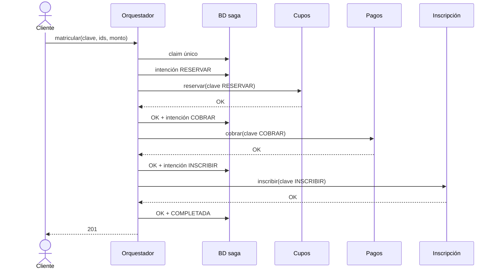
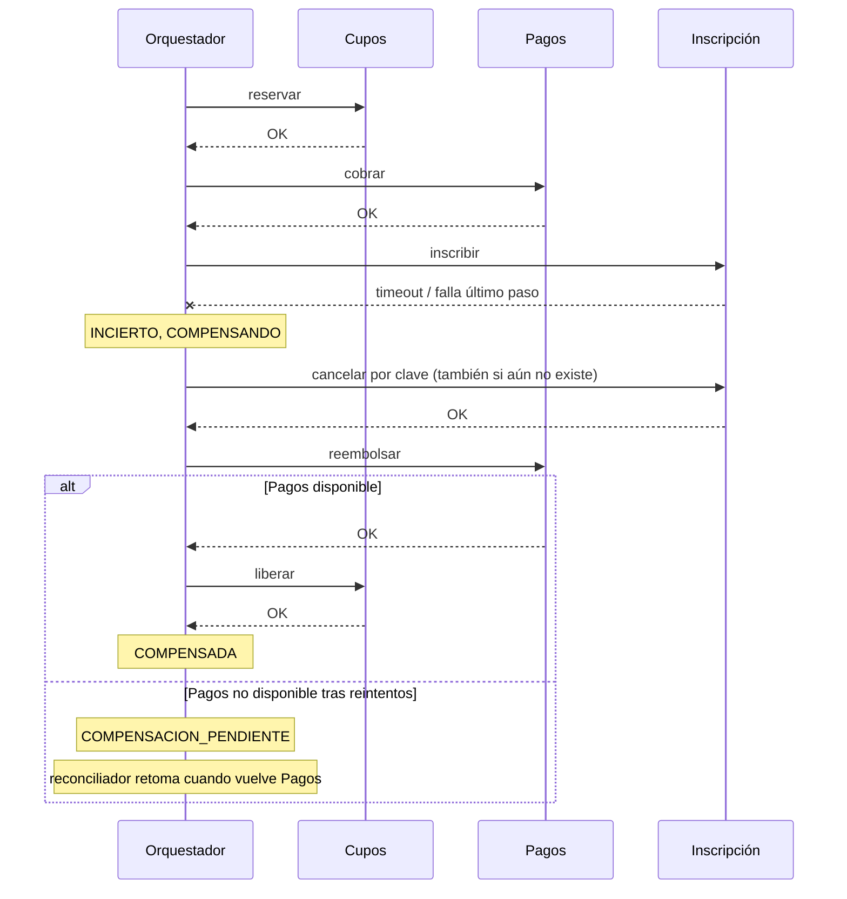
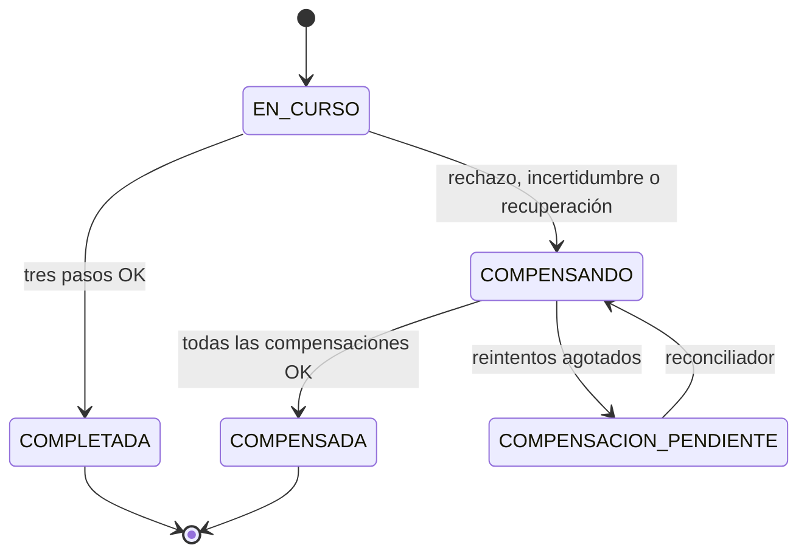

# Saga de matrícula — diseño y operación

## 1. Responsabilidades y contrato

El orquestador ejecuta RESERVAR → COBRAR → INSCRIBIR. Cupos conserva el invariante de capacidad; Pagos es un servicio externo a este repositorio; Inscripción conserva alumnos y registra solamente la inscripción local. `CONFIRMADA` significa inscripción ACTIVA y `ANULADA` significa baja. Se mantienen estos nombres para los consumidores existentes.

`POST /v1/matriculas`, con `X-API-Key: ORCHESTRATOR_API_KEY` e `Idempotency-Key`, recibe `{alumno_id, curso_id, monto}`. Monto es un entero positivo en unidades monetarias; la moneda debe acordarse con Pagos. Devuelve la saga: 201 si completa, 200 si se repite una completada, 202 si sigue en proceso o requiere conciliación, 503 si terminó compensada, 409 si otro intento ocupa el par alumno/curso y 422 si se reutiliza una clave con otro payload. Un rechazo definitivo queda registrado en `motivo_fallo`; el 503 expresa que la matrícula completa no se realizó. El cliente consulta `GET /v1/sagas/{id}`. Un replay devuelve el estado actual sin repetir efectos.

Inscripción acepta `Idempotency-Key` en `POST /v1/enrollments`; conserva el índice único por estudiante y clave de U1 para evitar revelar claves de otros estudiantes. Un reintento devuelve la fila existente, incluso ANULADA, sin reactivarla. Para reinscribirse se usa otra clave. La segunda baja y las bajas simultáneas responden 200. El índice parcial de inscripciones activas se conserva. Inscripción ya no llama a ocupar/liberar ni usa el circuit breaker para esas operaciones. Las consultas `/v1/courses` conservan su cliente y circuito de lectura de Cupos.

**Migración coordinada desde U1:** cambian deliberadamente las semánticas de alta/baja. Se conservan las rutas v1 para esta entrega; no se debe desplegar a consumidores U1 sin coordinarlos. El verificador conserva la base histórica y admite solamente la eliminación de los errores de Cupos en alta/baja y del 409 por segunda baja. No se reescribe la línea base para ocultar otras rupturas. Los experimentos de U1 son históricos y no representan el nuevo flujo.

**Datos existentes:** no se borran volúmenes. Las inscripciones CONFIRMADAS que ya tenían reserva en U1 siguen siendo históricas; darlas de baja ahora no libera automáticamente esa reserva. Antes de migrar, detener escrituras U1, conciliar y cerrar sus PENDIENTES y resolver las reservas de las matrículas que se darán de baja. Este cambio no adopta automáticamente operaciones antiguas dentro de sagas nuevas.

## 2. Persistencia, concurrencia y recuperación

`sagas` contiene id, idempotency_key UNIQUE, request_hash, alumno_id, curso_id, monto, estado, motivo_fallo, created_at y updated_at. Un índice único parcial sobre alumno/curso incluye EN_CURSO, COMPENSANDO, COMPENSACION_PENDIENTE y COMPLETADA. La inserción decide atómicamente la concurrencia; no se implementa un “consultar y después insertar”. Una COMPLETADA conserva el par ocupado. No se agrega un flujo de baja global de saga: la baja local no reembolsa ni libera recursos.

`saga_steps` contiene saga_id, paso, tipo (forward/compensacion), estado (PENDIENTE/OK/FALLIDO/INCIERTO), intentos, clave, error y timestamps, con unicidad por saga/paso/tipo. Cada intención se confirma antes de llamar. Claves forward: `{saga_id}:{paso}`; compensación: `{saga_id}:comp:{paso}`. En Cupos y cancelación de Inscripción se envía la clave original para identificar el recurso que se cancela; el registro de compensación mantiene su clave propia. Pagos recibe ambas claves.

Un paso incierto se compensa también. Un PENDIENTE encontrado tras una caída puede haber ejecutado el efecto y se trata como incierto. Las compensaciones se recorren en orden inverso, con reintentos y backoff exponencial acotados. Si una falla, se conserva COMPENSACION_PENDIENTE; no se liberan pasos anteriores hasta resolverla. Al arrancar y periódicamente se revisan sagas antiguas no terminales y se compensan. Los pasos de compensación OK no se repiten.

Se toma un candado por saga durante la ejecución y conciliación, independiente de los commits: advisory lock con conexión dedicada en PostgreSQL, o flock junto a la base SQLite. La base y sus archivos de candados deben vivir en el mismo volumen persistente para todos los workers SQLite. Una muerte del proceso libera el candado. No se debe borrar `.saga-locks` con procesos activos. SQLite no se comparte entre máquinas; para varias máquinas se debe configurar `SAGA_DATABASE_URL` con PostgreSQL y un pool acorde a la concurrencia.

Cupos registra una liberación anticipada sin incrementar capacidad. La misma clave no podrá ocupar después, aunque la reserva original llegue tarde. Una clave de otro curso sigue siendo inválida. Se desactiva la purga por defecto: borrar tombstones permite reejecutar solicitudes antiguas. Una retención finita exige una ventana de reintentos acordada entre todos los servicios. Inscripción tiene una cancelación interna por clave que también crea una fila ANULADA anticipada.

## 3. Resiliencia y operación

Cada dependencia tiene una instancia del circuit breaker de U1 y un semáforo independiente. Timeouts, errores de transporte, respuestas inválidas y 5xx cuentan como falla; rechazo de negocio e idempotencia 422 no abren el circuito. Si el circuito de Pagos está OPEN antes de comenzar, no se reserva. Un cambio de disponibilidad posterior puede requerir compensación. El bulkhead rechaza sin esperar, sin consumir cupos de concurrencia de otra dependencia.

`PUT /internal/fault` acepta `{falla: bool, lentitud_seconds: 0..30}`, exige `X-Internal-Key` y afecta solo al alta de Inscripción; la baja interna permanece disponible. El control se restablece al reiniciar el proceso y debe usarse con un worker para experimentos reproducibles. El gateway rechaza `/internal`; los servicios no publican puertos REST directamente. Administrar el interruptor desde la red interna, por ejemplo con `docker compose exec` y un cliente HTTP. No registrar los secretos en comandos compartidos.

Cada transición produce un mensaje JSON con saga_id, paso, estado y duracion_ms, sin cuerpos, RUT ni email. `docker compose logs orquestador` permite ver el orden inverso. `/metrics` expone sagas por estado, compensaciones OK persistidas, duración agregada por paso/dependencia (sum/count), estado de circuitos y rechazos del bulkhead. Circuitos, contadores de llamadas y controles de falla son locales al proceso y se reinician con él.

**Contrato requerido de Pagos (pendiente de integrar con su responsable):**

| Operación | Petición | Respuesta |
|---|---|---|
| POST /v1/payments | alumno_id, curso_id, monto; Idempotency-Key forward | estado COBRADO; rechazo 4xx o estado RECHAZADO |
| POST /v1/payments/refund | original_key; Idempotency-Key de compensación | estado REEMBOLSADO o INEXISTENTE |
| GET /v1/payments/by-key/{clave} | X-API-Key | estado COBRADO, REEMBOLSADO o INEXISTENTE |

Pagos debe hacer el reembolso repetible y guardar una cancelación anticipada cuando no existe el cobro; un cobro tardío con esa clave no puede ejecutarse. El cliente no considera un 404 de reembolso como éxito: se exige el contrato explícito. Solo viajan ids, monto y claves; no se almacenan ni transportan datos de tarjeta. El adaptador no envía RUT ni email. La implementación real de Pagos y su moneda no estaban presentes en el proyecto; `PAGOS_URL` debe apuntar al servicio compatible. No se incluye un simulador como servicio productivo.

## 4. ADR breves

**ADR-6: orquestación sobre coreografía.** Decisión: orquestación persistente. Tres pasos lineales, una máquina de estados y compensación demostrable favorecen un coordinador central. Costo: acoplamiento con los tres contratos y un punto único de falla. Mitigación: estado durable, intención previa a cada llamada, exclusión por saga y recuperación periódica; el coordinador puede reiniciarse sin repetir efectos.

**ADR-7: saga sobre 2PC.** La pasarela externa no participa en 2PC. Mantener bloqueos mientras el coordinador o la pasarela fallan perjudica disponibilidad. Se acepta falta de aislamiento: durante la saga hay un cupo reservado sin pago confirmado. El reembolso es compensación semántica, no rollback; puede tardar y quedar pendiente. Backoff y límites de reintentos acotan carga y costo hacia la pasarela.

## 5. Diagramas y validación

Pruebas rápidas: `python -m pytest tests/unit -q`. Cubren clientes falsos, errores de negocio, incertidumbre, orden inverso, reintentos, recuperación con nueva instancia, concurrencia, claves reutilizadas, reinscripción, interruptor protegido y validación de respuestas reales en proceso contra OpenAPI. Cupos tiene una prueba obligatoria de liberar sin reservar: no sube capacidad y rechaza una reserva tardía.

La suite de red existente cubre Inscripción y Cupos. `test_saga_procesos.py` levanta servicios aislados con HTTP/gRPC reales y un doble explícito de Pagos: prueba los cinco escenarios, los invariantes y SIGKILL real sin Docker. Las pruebas marcadas `falla` requieren Docker. `tests/integration/test_saga_docker.py` requiere además un Pagos compatible y las variables de acceso; mata el orquestador con una inscripción en vuelo y espera la conciliación. El script `scripts/verificar_invariantes.py SAGA_ID...` consulta los tres servicios: COMPLETADA requiere reserva activa, COBRADO e inscripción activa; COMPENSADA requiere reserva inactiva, REEMBOLSADO/INEXISTENTE y ninguna inscripción activa de esa clave. Necesita ORCHESTRATOR_API_KEY, SERVICE_API_KEY y las URLs accesibles; usar el override de tests para acceder a gRPC desde el host.
